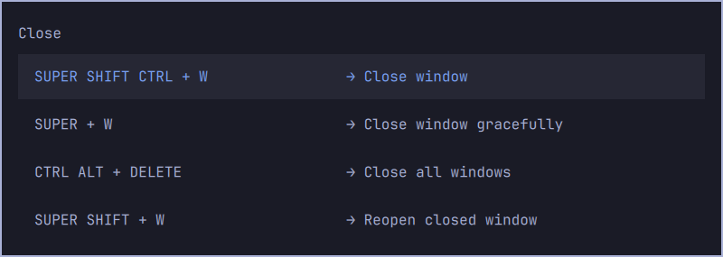

# Grace Window (jam.grace-window)



An Omarchy shell plugin to reopen a recently closed window,
including its content with
<kbd>SUPER</kbd>+<kbd>SHIFT</kbd>+<kbd>W</kbd>. The plugin rebinds
<kbd>SUPER</kbd>+<kbd>W</kbd> to move the focused window silently to
**workspace 10** with a one-minute reopen grace period until it gets
closed for real:

- <kbd>SUPER</kbd>+<kbd>W</kbd>: close window gracefully: silently move the
  focused window to **workspace 10** and start the one-minute reopen grace
  period. Active workspace stays where it was.
- <kbd>SUPER</kbd>+<kbd>SHIFT</kbd>+<kbd>W</kbd>: reopen closed window:
  bring it back, focus it, and cancel its grace period. If the focused window
  is itself a gracefully closed window, that one is reopened instead.
  Otherwise reopens the most recently closed window. Moving a gracefully
  closed window out of its grace workspace also reopens it.
- <kbd>SUPER</kbd>+<kbd>SHIFT</kbd>+<kbd>CTRL</kbd>+<kbd>W</kbd>: close
  window, for real, immediately. It can not be reopened again.
- **Grace period**: time to reopen gracefully closed window before it gets
  closed for real. Pauses if gracefully closed window is focused.
- **Grace look**: a gracefully closed window gets a distinctive look so you
  can tell it will close soon: a 10% lower opacity, cut corners and always in
  *tiling* mode.
- **Grace groups**: the behaviour is as you would expect in omarchy:
  Only the focused window of a tabbed group gets gracefully closed, the rest of
  the group stays in place. On reopen the window joins the group that
  currently has focus (if possible).
- **Grace scratchpad**: when the scratchpad is open, the reopened
  window lands on the scratchpad instead of the workspace underneath it.

The Plugin also can be used nicely to reorganize your tiled workspace, as
reopened windows will appear to the right or bottom of the focused window,
depending on its aspect ratio (like a newly opened window would).
You can even change the order of the windows in your tabbed group with this.

Grace Window is a *service* plugin: the state lives in the long-lived
`omarchy-shell` process, and the keybindings drive it over Quickshell IPC
(`omarchy-shell grace-window hide` / `reopen`), so there is no standalone
background script.

## Files

| File | Purpose |
|------|---------|
| `manifest.json` | Omarchy plugin manifest (schema v1, kind `service`) |
| `Service.qml` | The service: IPC handlers, a single serial hyprctl dispatch queue (with watchdog), an event-driven grace tracker (focus, liveness and workspace moves come from Hyprland's event socket, so the timer never probes), and automatic wiring of the keybindings on start / unwiring on teardown |
| `hypr/bindings.lua` | The shipped keybindings, wrapped in the managed block. Used on start unless a captured customization exists (see [Configuration](#configuration)) |
| `scripts/*` | `.sh`, `.lua`, `.jq` and `.awk` scripts backing the service |

## Install

```bash
omarchy plugin add https://github.com/Jan-Berberich/omarchy-grace-window.git --enable
```

When the service starts it appends the managed keybinding block to
`~/.config/hypr/bindings.lua` and reloads Hyprland, but only if the block is
not already present, so it is safe across shell restarts and plugin
hot-reloads. The block is the plugin's own `hypr/bindings.lua`, or your
customized `hypr/bindings-custom.lua` (when one was captured on a previous
teardown). Every line it adds lives inside a `-- BEGIN Grace Window …` /
`-- END Grace Window …` managed block pair. Nothing outside that block is ever
modified.

## Uninstall

```bash
omarchy plugin remove jam.grace-window
```

Removing the plugin shuts down its service, and the service first strips
exactly the plugin's managed binding block from
`~/.config/hypr/bindings.lua` and reloads Hyprland. Every binding that was
already present before the plugin was installed is preserved unchanged. If
the managed block cannot be located intact, or appears more than once, the
service fails closed and leaves the file untouched.

## Usage without the keybindings

Talk to the service directly from a terminal:

```bash
omarchy-shell grace-window hide '10' 60 30 1 0.9 # hide focused window, start grace
omarchy-shell grace-window reopen '10'           # bring the newest hidden window back
omarchy-shell grace-window status                # returns "idle" or "pending <N>s"
omarchy-shell grace-window cancel                # forget pendings, restore grace look
```

The arguments for the `hide` command are:
- `<workspace>`: where the window silently goes
  (and the key of its grace buffer).
- `<period>`: the grace period in seconds.
- `<rounding>`, `<rounding_power>`: change the window's corners
  to mark the grace look.
- `<opacity_factor>` scales the window's opacity.

`reopen` takes the `<workspace>` of the window to bring back. Each workspace
keeps its own buffer of hidden windows, so multiple workflows can coexist.

## Configuration

There are two places to configure the plugin: the **keybindings**, in your live
`~/.config/hypr/bindings.lua`, and the **service tunables**, in the generated
`~/.config/omarchy/plugins/jam.grace-window/config.json` next to the plugin's
own files. An edit to `config.json` is applied automatically: the service
watches the file (and its directory) and re-reads it as soon as it changes, so
no plugin restart is needed.

### Keybindings
Edit the managed block in your live `~/.config/hypr/bindings.lua` (inside the
`-- BEGIN Grace Window …` / `-- END Grace Window …` pair) while leaving those
two marker comments in place. In the block you can change / add keybindings
and edit the following command arguments:
- **Grace workspace**: 1st argument of the `hide` / `reopen` commands.
- **Grace period**: 2nd argument of the `hide` command in seconds.
- **Grace look**: 3rd … 5th arguments are: rounding, rounding power,
  opacity factor.

A customization made there is captured to `hypr/bindings-custom.lua` on
teardown and wired back on the next start. A block that still matches what the
last start wired is not captured, so the custom file only appears once you
have actually customized the block.

### Service Tunables
Next to the plugin files lives
`~/.config/omarchy/plugins/jam.grace-window/config.json`. It holds the
service's own tunables and is written with the defaults below the first time
the service starts:

| Key | Default | Meaning |
|-----|---------|---------|
| `groupingDelayMs` | `100` | Milliseconds to wait after (un)grouping before continuing. `0` is snappier; higher values prevent graphics glitches after (un)grouping. If some apps glitch with the **Grace groups** feature, increase this. |
| `closeRetryMax` | `3` | Failed close attempts before the plugin gives up and restores the grace look in place (so a window is never stranded looking pending). |
| `queryTimeoutMs` | `10000` | Abort a hung `hyprctl` command after this many milliseconds, so it can never wedge the dispatch queue. |
| `loadWaitLimit` | `40` | Startup retries (each after `loadRetryIntervalMs`) waiting for the keybinding wiring to finish before the saved state is loaded. |
| `sweepIntervalMs` | `500` | Grace countdown tick rate, in milliseconds. |
| `loadRetryIntervalMs` | `500` | Cadence of the startup-load retry, in milliseconds. |
| `openWaitMs` | `5000` | How long the backing shell script may wait for one bounded read-only open before giving up, in milliseconds. |

Every value is validated: an entry that is missing, of the wrong type, or out of
range falls back to its default on its own, so a typo never discards the rest.
A `config.json` that is not valid JSON is reported and the defaults are used
without rewriting the file, so a hand-edit is never silently undone. Deleting
the file makes the next start recreate it with the defaults.

**Example**: You can configure custom behaviour, like a "Minimize / Recover"
workflow (hide on workspace 9 with no auto-close and only subtle look change)
by adding the desired keybindings to the managed block in
`~/.config/hypr/bindings.lua`:
```
hl.unbind("SUPER + ALT + W")
o.bind("SUPER + ALT + W", "Minimize window (jam.grace-window)", "omarchy-shell grace-window hide '9' 9e9 9 1 1")
hl.unbind("SUPER + ALT + SHIFT + W")
o.bind("SUPER + ALT + SHIFT + W", "Recover window (jam.grace-window)", "omarchy-shell grace-window reopen '9'")
```
Since each hide target keeps its own buffer of hidden windows, any number of
such workflows can coexist.

## Notes

- The plugin manages persistent window states: shutting the service down
  (restart, hot-reload, logout) saves the pending state to the per-user
  runtime dir. The next start restores every hidden window still on the
  workspace it was hidden into: look, remaining grace time and reopenability
  all carry over. Windows moved or closed while down are skipped, windows
  mid-reopen are treated like pending, and `cancel` (or a close given up after
  `closeRetryMax`) clears the saved state so such a window is never
  resurrected or re-armed.
- Multiple windows can be hidden in sequence, in any number of
  workspaces. Each one keeps its own grace period in its workspace's buffer,
  and `reopen <workspace>` restores the most recent one of that workspace
  (or the focused window if it was hidden to this workspace).
- `cancel` (or stopping the service) restores the grace look of every pending
  window in place. It does not move or close them.
- Re-hiding a window always restarts its full grace period, so `status`
  reports the fresh pending seconds. A pending window that is gone from
  Hyprland for any other reason (closed on its own, crashed) is dropped by its
  `closewindow` event, so `status` never counts a window that no longer
  exists.
- Reopening a floating or pinned window on a different monitor than the one it
  was hidden on keeps its place within the monitor: it reappears at the same
  position relative to the monitor it lands on, instead of at its old absolute
  screen coordinates.
- Every file the plugin reads or writes (managed keybinding block, teardown
  copy of the scripts, saved state) goes through a directory descriptor that
  was opened, checked and then kept open, and is published with an atomic
  rename from a randomly named temporary file in that same directory. A name
  swapped for a symlink, a directory replaced while the plugin works, or a
  temporary name planted in advance therefore cannot redirect a read/write;
  a target replaced underneath the plugin is left untouched and the command
  fails. The script also refuses to write when a path component is a symlink,
  when a directory in the path is group/other writable, or when the target is
  not a regular file owned by you (or root), which is why a symlinked
  `~/.config/hypr` (through a dotfiles manager, say) is the one setup that
  stops working. No open can wait, either: a fifo swapped in for a file or a
  directory is opened the way that returns at once and then refused, and a
  read-only open is delegated to a child with a five-second deadline, so a
  swap is a command that fails and says so, never a service that stops
  answering. The jq module and the Lua dispatcher are the exception: those are
  found by name inside jq's and Hyprland's own processes, where the plugin's
  descriptors do not exist.
- The custom bindings and the wired-block reference are best-effort sidecars
  and obey the same rules: a custom file that cannot be read (unreadable, a
  symlink, a shared-writable directory in its path) is reported and the shipped
  default is wired instead, and a capture that cannot be written is reported
  but never stops the strip. The managed block in `~/.config/hypr/bindings.lua`
  itself stays fail-closed: a damaged or duplicated block is left untouched.
- `config.json` is best-effort too: a file that cannot be read, is not valid
  JSON, or holds an unusable value is reported, and the defaults (whichever
  entries are affected) are used instead, so the service never fails to start
  because of its configuration. The file is created only when it does not
  exist, so the defaults written on first start are the initial content and a
  hand-edited file is never overwritten.
- Validated with `omarchy plugin validate`.
